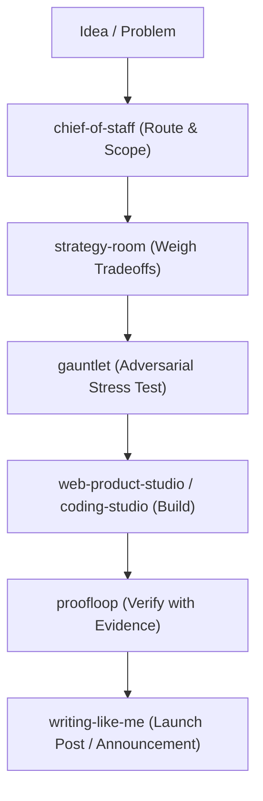

# How to Use Curiosity Kit

Curiosity Kit is fundamentally designed as a **"Multi-Disciplinary Studio in a Box"** for solo founders, creative technologists, researchers, and technical creators who wear every hat.

While most coding agent plugins focus exclusively on software engineering (linting, refactoring, git diffs), Curiosity Kit spans the **entire lifecycle of an idea**: from pre-commitment strategy and founder economics, to high-craft media and voice-matched writing, to web product implementation and evidence-gated autonomous loops.

---

## The 4 Sweet-Spot Project Types

### 1. The 0-to-1 Solo Founder & Product Incubation Pipeline
*When you have a raw concept and need to turn it into a validated, working business and product.*

- **Where it shines**:
  - **Pre-commitment Strategy**: [`strategy-room`](skills/strategy-room/SKILL.md) challenges your assumptions and weighs alternatives before you write code.
  - **Adversarial Stress-Testing**: [`gauntlet`](skills/gauntlet/SKILL.md) attacks your business and architecture hypotheses, finding blind spots.
  - **Economics & Packaging**: [`founder-revenue-engine`](skills/founder-revenue-engine/SKILL.md) structures pricing models, offer tiers, and customer discovery.
  - **Working MVP**: [`web-product-studio`](skills/web-product-studio/SKILL.md) takes UI references directly into code with real browser verification.
- **Best used for**: Bootstrapping SaaS products, micro-apps, client agency offerings, or technical service tools.

---

### 2. Technical Thought Leadership & High-Craft Media
*When you need to publish technical content, educational deep dives, or creative assets that must NOT sound or look like generic AI slop.*

- **Where it shines**:
  - **Anti-Slop Voice Matching**: [`writing-like-me`](skills/writing-like-me/SKILL.md) applies strict "Unslop" heuristics, checks claims, and preserves your authentic cadence, humor, and purposeful roughness across essays, LinkedIn, and X posts.
  - **Pedagogical Breakdowns**: [`explanation-studio`](skills/explanation-studio/SKILL.md) crafts mental models and intuition pumps for complex technical ideas.
  - **Visual & Video Production**: [`visual-production-studio`](skills/visual-production-studio/SKILL.md) and [`ai-film-studio`](skills/ai-film-studio/SKILL.md) generate model-calibrated prompts (Midjourney, Flux, video generators), maintain character/spatial continuity across cuts, and compile camera shotlists.
  - **High-Throughput Creator Cadence**: [`matt-pocock-knowledge-work`](skills/matt-pocock-knowledge-work/SKILL.md) applies the proven daily capture-to-script workflow used by top developer educators.
- **Best used for**: Developer newsletters, technical blog posts, YouTube/video essay scripting, conference talks, and brand launches.

---

### 3. High-Stakes Decisions & Complex Problem Solving
*When making the wrong choice is expensive or irreversible, and you need evidence rather than generic advice.*

- **Where it shines**:
  - **Executive Wayfinding**: [`chief-of-staff`](skills/chief-of-staff/SKILL.md) organizes priorities and delegates to the right specialist without imposing rigid overhead.
  - **Evidence-Gated Proof**: [`proofloop`](skills/proofloop/SKILL.md) rejects superficial completions; tasks must have verifiable, reproducible proof before they are marked done.
  - **Recent Ecosystem Intel**: [`last30days`](skills/last30days/SKILL.md) synthesizes fast-moving tech developments from the past month to keep decisions current.
- **Best used for**: Architecture migrations, vendor/tech-stack selections, investor memos, and multi-week project planning.

---

### 4. Agent Engineering & Multi-Host Workflows
*When you are building custom AI agents, multi-agent teams, or running across multiple CLI assistants.*

- **Where it shines**:
  - **Multi-Host Parity**: Runs natively and identically on **Antigravity CLI (`agy`)**, **Codex**, and **Claude Code**.
  - **Agent & Tool Design**: [`agent-ops`](skills/agent-ops/SKILL.md) and [`harness-engineering`](skills/harness-engineering/SKILL.md) help you design clean subagents, contract interfaces, and bounded loops.
  - **Controlled Autonomy**: [`loopkit`](skills/loopkit/SKILL.md) and [`loop-observatory`](skills/loop-observatory/SKILL.md) give you verifiable autonomous execution without runaway token loops.

---

## How Curiosity Kit Fits into Your Workspace Ecosystem

| Work / Task | Recommended Plugin / Skill | Why |
| :--- | :--- | :--- |
| **0-to-1 Solo Product / Multi-Hat Project** | **Curiosity Kit** | Combines Strategy + Creative + Coding + Voice in one harness. |
| **Authentic Writing & Media (Anti-Slop)** | **Curiosity Kit** (`writing-like-me`, `ai-film-studio`) | Purpose-built anti-slop rules, voice guides, and shotlist compilers. |
| **Cross-Agent Dispatch & Heavy Orchestration** | **`quintet` / `oh-my-claudecode`** | Designed specifically for spinning up tmux worker teams and multi-CLI fleets. |
| **Infrastructure / Sysadmin Ops** | **`vdw-proxmox-core` / `vdw-opnsense`** | Deep specialized scripts for hypervisors, ZFS pools, and firewalls. |
| **Social Media API Scheduling / MCP Tools** | **`zernio-claude-plugin`** | Direct API execution for 15+ social networks. (Curiosity Kit writes it; Zernio publishes it). |

---

## Example Workflow: A Complete Feature from Scratch

Whenever you find yourself shifting between **"What should I build?"**, **"How do I build it cleanly?"**, and **"How do I explain/launch it to people?"**, Curiosity Kit is the exact right harness to activate.

---

## Quick Reference: The 26 Skills by Function

### 1. Executive & Strategy
- **`chief-of-staff`**: General workflow orchestrator, prioritizer, routes to specialists, keeps commitments without forcing heavy rituals.
- **`strategy-room`**: High-stakes pre-commitment decision wayfinding, assumption challenge, option comparison, proof-to-product mapping.
- **`gauntlet`**: Adversarial stress-testing of plans, contracts, hypotheses, and architectural decisions.
- **`founder-revenue-engine`**: Business model validation, offer design, pricing, customer discovery, revenue mechanics.

### 2. Writing & High-Craft Content
- **`writing-like-me`**: Voice-matched writing (articles, LinkedIn, X, business memos), claim checking, anti-slop ("Unslop"), voice guides.
- **`data-storytelling-studio`**: Data memos, visual storyboards, chart claims audit, uncertainty preservation.
- **`explanation-studio`**: Deep explanations, pedagogical breakdowns, mental models, making complex concepts intuitive.
- **`matt-pocock-knowledge-work`**: High-throughput creator knowledge workflows inspired by Matt Pocock (daily captures, concept distilling, video/post scripts).

### 3. Visual & Creative Media
- **`visual-production-studio`**: Model-specific image & video prompts (Midjourney, Flux, SD), storyboards, typography, layout/editorial.
- **`ai-film-studio`**: Shotlists, scene scripts, asset/spatial continuity across cuts, frame review, production packages.
- **`guide-production-studio`**: Polished visual guides, cheat sheets, practical workshop structures.

### 4. Full-Stack & Systems Engineering
- **`web-product-studio`**: End-to-end web product development (reference-to-code, full stack components, real browser verification).
- **`coding-studio`**: Bounded coding, refactoring, bug fixes, code reviews, migrations.
- **`harness-engineering`**: Meta-engineering, packaging plugins, multi-host adapter design, building agent harnesses.
- **`agent-ops`**: Designing reusable agents, tool interfaces, prompt contracts, and bounded subagents.

### 5. Research & Knowledge Preservation
- **`last30days`**: Rapid discovery and synthesis of recent developments, tech shifts, and releases in a topic.
- **`continuity-vault`**: Cross-session memory and context handoffs, promotion decisions, trust audits.
- **`memory`**: Local workspace working memory and structured memory graphs.
- **`knowledge-work-superpowers`**: High-leverage knowledge worker frameworks and personal operating leverage.
- **`practice-compiler`**: Turning repeated workflows into standard operating procedures and compiled checklists.

### 6. Verification & Autonomous Execution Loops
- **`loopkit`**: Autonomous goal loops, bounded iterations, loop state tracking across sessions.
- **`loop-observatory`**: Audit and metrics for agent loops, identifying drift, runaway token consumption, or repeated failure cycles.
- **`proofloop`**: Evidence-gated task finishing—proving a claim or fix with reproducible tests/logs before calling it done.
- **`outcome-engine`**: Goal decomposition tied strictly to concrete, verifiable outcomes.
- **`model-prompt-lab`**: Benchmarking, prompt optimization, model comparison, evaluation runs.
- **`operating-graph`**: Explicit execution graphs with dependencies, approvals, and controller join states.
